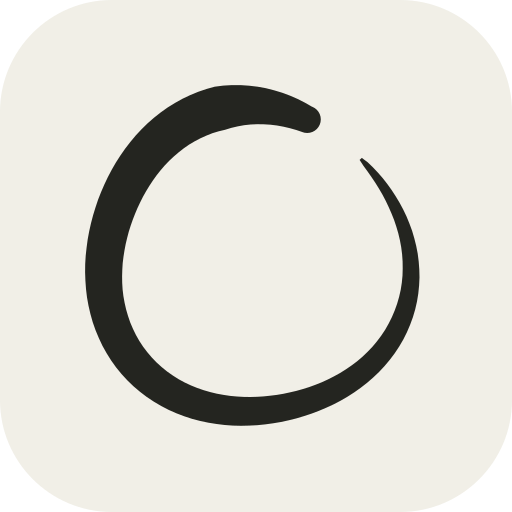
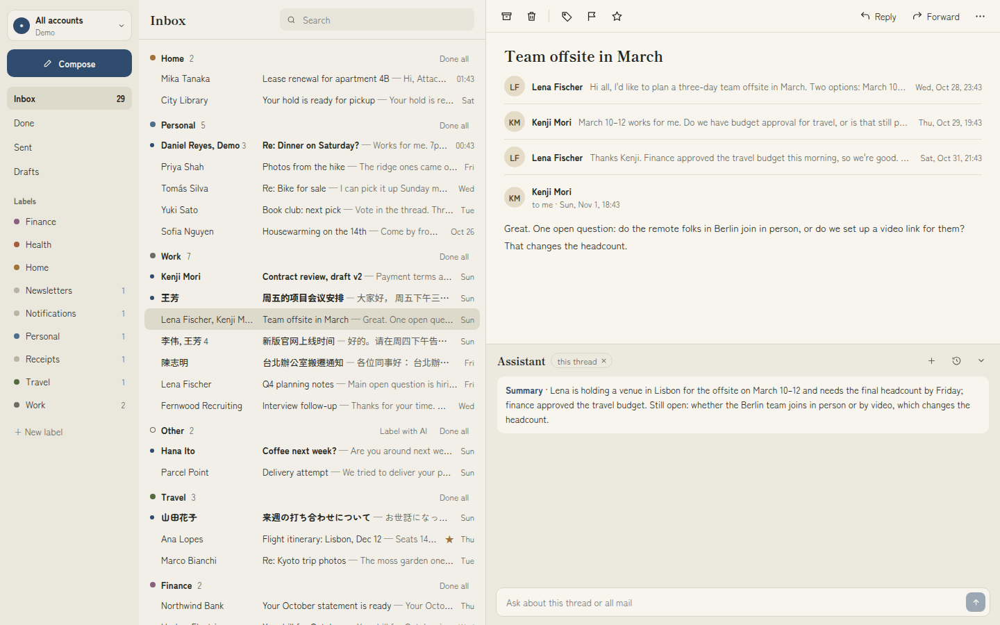

# kanso

簡素 means *simplicity*. kanso is a calm, self-hosted email client for Gmail, built for getting to
inbox zero. It keeps a copy of your whole mailbox, every year of it, on your own server, so reading
and searching are fast and nothing is cut off after 90 days. There is no paid tier and no account
with anyone but Google.



- **Inbox zero.** Mark threads done (`e`), undo (`z`), and clear a whole label section or bundle at
  once. Everything you do is written back to Gmail, so other Gmail apps stay in step.
- **Full history.** Every message of every connected account is synced and searchable with
  Postgres full-text search, Chinese and Japanese included.
- **Keyboard first** on the desktop (`?` lists the shortcuts), and **swipe** on a phone, where
  kanso installs as an app.
- **Several Gmail accounts**, together or one at a time.
- **Optional AI** with your own Anthropic API key: new mail sorted into your labels, short summaries
  of long threads, and an assistant that answers questions about your mail. Without a key kanso is
  a plain email client and shows no AI features.

kanso is a personal project for one person running it on their own machine or server. It is not a
hosted service.

## Quick start

You need Docker with Docker Compose, and about 20 minutes for the Google Cloud setup.

```sh
git clone <this repository's URL> kanso
cd kanso
scripts/setup.sh    # needs the gcloud CLI; or: cp .env.example .env and set it up by hand
```

Then follow [docs/SETUP.md](docs/SETUP.md). It walks you through creating your own Google OAuth
client and Pub/Sub subscription, filling in `.env`, setting your password, starting kanso with
`docker compose up -d`, connecting your accounts, and installing kanso on your phone.

To look around before connecting a real account, fill in `.env` (SETUP.md, step 6), start kanso
and load a made-up mailbox:

```sh
docker compose exec app python -m kanso.demo_seed
```

## Demo instance

To try kanso without any Google setup, start a demo instance. It is the full app (app, worker,
Postgres and Redis) showing a made-up mailbox, at `http://localhost:8001` with the password `demo`:

```sh
./demo.sh                         # AI off
./demo.sh <anthropic-api-key>     # AI on, using this key
# or: docker compose -f docker-compose.demo.yml up --build
#     (DEMO_ANTHROPIC_API_KEY for AI, DEMO_PORT for another port)
```

Archive, delete, labels, compose and send all work on the demo mail only: nothing reaches Google,
and no Gmail account can be connected. Every change resets each day at midnight UTC and whenever
the demo restarts. It is a separate Compose project (`kanso-demo`), so it can run beside your own
kanso and never touches its data or `.env` settings. With a key, the demo mail is sent to Claude
like real mail would be, and anyone you let into the demo uses AI on your key. Stop it with
`docker compose -f docker-compose.demo.yml down`.

## Good to know

- **HTTPS.** kanso doesn't do HTTPS itself. To use it from your phone or anywhere but the machine
  it runs on, put it behind a reverse proxy such as [Caddy](https://caddyserver.com/) or
  [Tailscale](https://tailscale.com/kb/1312/serve). The phone app needs HTTPS to install.
  [SETUP.md, step 8](docs/SETUP.md#8-reaching-kanso-over-https) shows both.
- **What goes to Claude.** Only with an Anthropic API key set, and only what each feature needs:
  for labeling, a new message's sender, subject and trimmed text; for a summary, each message's
  sender, date and trimmed text; for the assistant, your question and what it looks up. Never
  recipients or attachments, and never your whole mailbox in bulk. `.env.example` lists the
  details. The assistant changes mail (archive, label, star, mark read) only after you confirm,
  unless you turn that off in Settings. It can't send or delete mail.
- **Your data.** Mail, labels and settings live in the bundled Postgres database. Back it up with
  one command ([SETUP.md, Backups](docs/SETUP.md#backups)).
- **Upgrading.** `git pull`, then `docker compose up -d --build`
  ([SETUP.md, Upgrading](docs/SETUP.md#upgrading)).

## Development

The backend is Python (FastAPI, SQLAlchemy, uv) in `backend/`, the frontend React and TypeScript
(Vite, Bun) in `frontend/`.

```sh
cd backend && uv run pytest    # set TEST_DATABASE_URL to a throwaway Postgres for the database tests
cd frontend && bun run lint && bun run build
```

## License

[AGPL-3.0](LICENSE). If you run a modified kanso for other people, you have to offer them your
source code.
